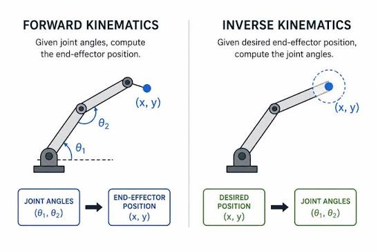
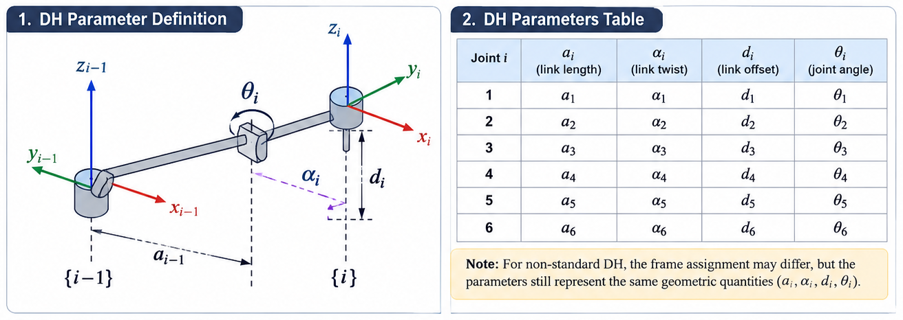
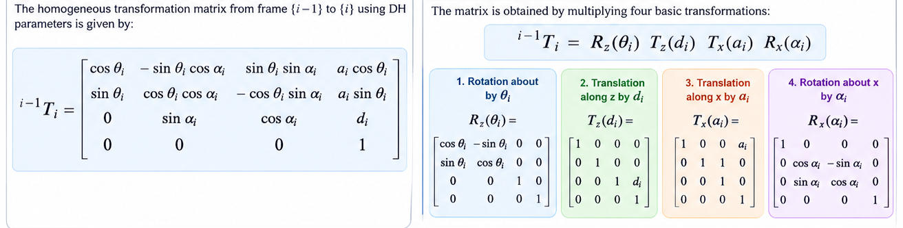
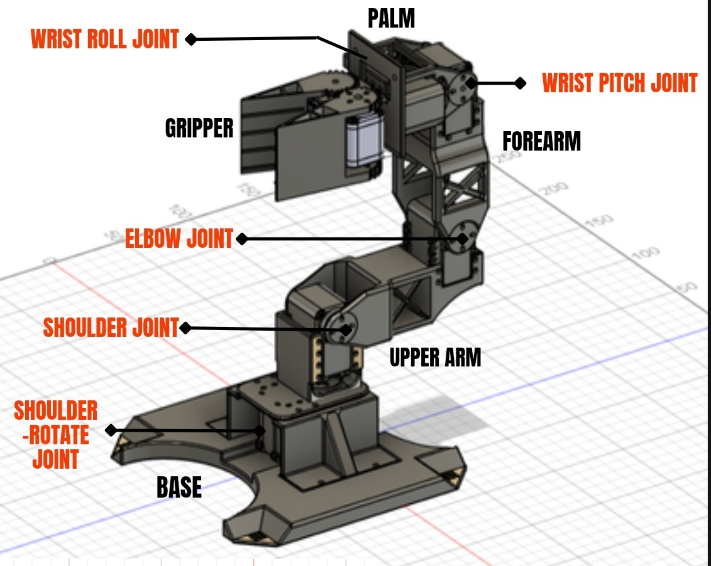
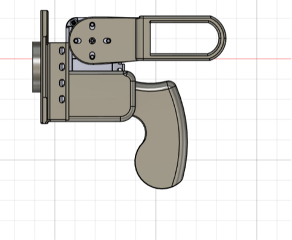
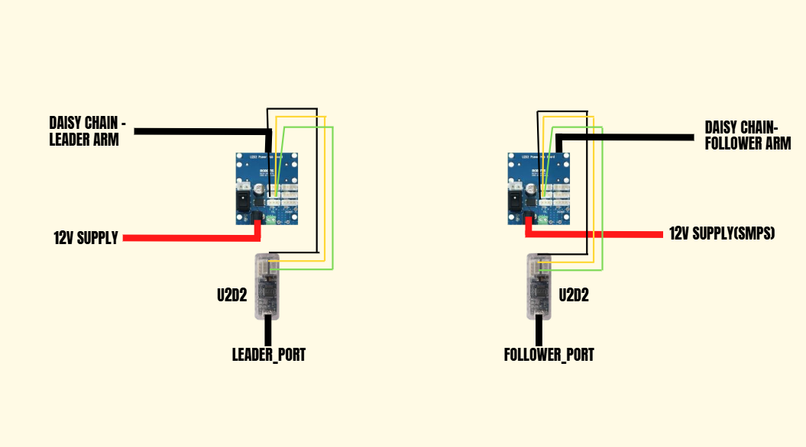
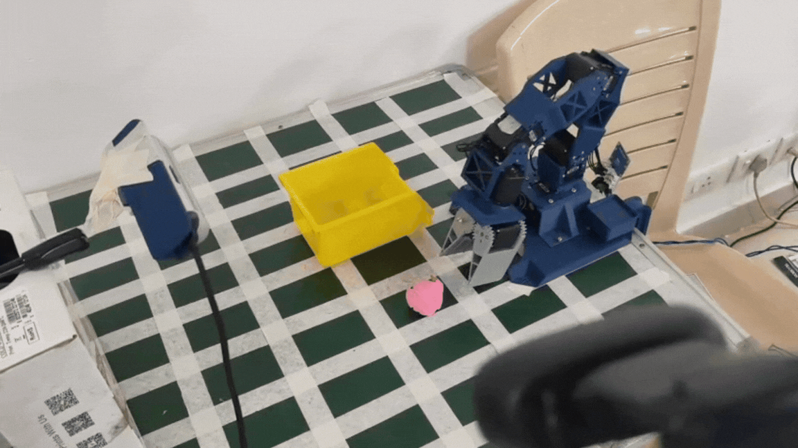

# Leader Follower Robotic arms with VLA

## Objective
To develop a leader-follower robotic arm system for teleoperation such that follower arm imitates the leader arm, where leader arm is manually controlled, and
integration with Vision Langauge Action(VLA) model to enable autonomous single object pick and place task execution.

## Robot Kinematics
**Forward Kinematics** when the angles that links make with respect to each other are known and end-effector position is calculated using the known angles.
**Inverse Kinematics** when the end effector positions are known and orientation of links or the angles need to be calculated.

**DH Parameter** Denavit–Hartenberg (DH) parameters are a standardized way of describing the geometric relationship between consecutive links and joints of 
a robotic arm using four parameters.

**Transformation Matrix** A transformation matrix is a 4x4 matrix used to describe the position and orientation of one coordinate frame relative to another.
It contains a 3x3 rotation matrix and 3x1 translation matrix.

## Simulation
**Matplotlib** 3R plot

**MuJoCo** IK, FK and Teleoperation using Trossen vx300s Arm.

## CAD DESIGN 
Once Mathematical Foundation and exploring dynamixel_sdk was finished, we designed the robotic arm on Fusion 360. The Link lengths were calculated in accordance to
the stall torques of both Dynamixel AX12-A (1.5 N-m)/ AX18-A (1.8 N-m). The Dimensions are -
1) Shoulder Holder - 45mm
2) Upper Arm - 86mm
3) Forearm - 100mm
4) Palm - 57mm
5) Roll Holder - 13mm
6) Gripper - 60mm
7) Total Teeth in Gripper Gear = 26
8) Module of Gripper Teeth = 0.9615

## System Overview
The setup consists of -
1) 10 Dynamixel AX12-A motors/ 2 Dynamixel AX18-A motors
2) 2 Power Hub Boards
3) 2 U2D2
4) 1 SMPS(Switched Mode Power Supply) and a 12 V Adaptor.
5) c270 webcam and Intel RealDepthSense Camera(only for VLA integration)
6) 3 pin cables

 

## Teleoperation Demonstration
 

## LeRobot Setup 
LeRobot Environment was setup. For the procedure, follow -[LeRobot Installation](https://huggingface.co/docs/lerobot/en/installation)

## Camera Setup
1) c270 webcam was used to oblique overhead view such that most of the arm movement was visible.
2) Intel Real Sense Camera for front gripper view.
3) Board with grids.

## Dataset collection 
Dataset was collected with the help of teleoperation to pick up and place a pink paper ball inside a yellow container. In each episode, the encoder values of leader
gets stored in a .paraquet file and videos from both camera gets stored as .mp4 file. Around 78 such episodes were recorder and combined together before training.
 

## Policy Training
Dataset was trained on LeRobot ACT(Action Chunking with Transformer). ACT is an imitation-learning policy that uses multi-camera visual observations and the robot's current state to predict a sequence of future robot actions, learned from human teleoperation demonstrations.
 

## Policy Deployment
 

